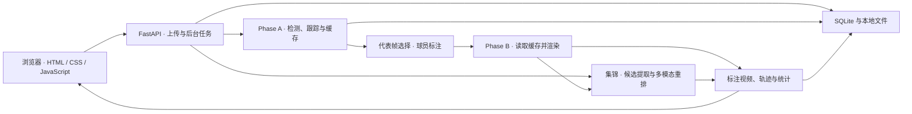

# GoalScope · 足球视频分析系统

GoalScope 面向足球比赛和训练录像，支持球员与足球跟踪、动态战术可视化和精彩集锦生成。

## 系统架构

前端负责上传、球员标注、进度查询和分析结果展示。FastAPI 调度后台任务，SQLite 记录视频和分析结果，本地文件系统存放源视频、追踪缓存和导出文件。推理、渲染和集锦生成分别由 [analysis.py](backend/analysis.py) 和 [highlight_generator.py](backend/highlight_generator.py) 实现。

## 处理流程与算法

| 阶段 | 实际处理 |
| --- | --- |
| 1. 上传与解码 | FastAPI 接收视频并建立记录。OpenCV 读取帧和视频元数据，Phase A 按帧间隔采样检测。 |
| 2. 球员与足球检测 | Ultralytics YOLO 输出球员框，再按框的高度、宽高比和画面纵向区域剔除部分误检。足球使用独立的 YOLO 检测权重，结合卡尔曼预测维持球轨迹。 |
| 3. 球员身份关联 | 用卡尔曼滤波预测球员框，用 OSNet 提取外观特征，缺少可用模型时回退到 HSV 直方图。把外观余弦相似度、预测框 IoU 和历史时空相似度组合成代价矩阵，通过匈牙利算法做第一轮关联，再用 Re-ID 对剩余检测和轨迹尝试补配。 |
| 4. 镜头运动与球队识别 | 用 Shi–Tomasi 角点和金字塔 Lucas–Kanade 光流寻找相邻帧的匹配点，再用 RANSAC 估计帧间单应矩阵，供运动补偿使用。球队识别对球员框上半身的 HSV 色相和饱和度做二类 K-means 聚类。 |
| 5. 代表帧与人工确认 | 缓存每帧追踪框与足球位置。优先挑选可见球员多、能补充未覆盖轨迹 ID 的帧，并设置最小时间间隔。用户在这些帧上确认球员、填写球衣号码或排除误检，标注随轨迹 ID 传给后续阶段。 |
| 6. Phase B 与可视化 | 读取 Phase A 缓存，在未采样帧使用最近可用的追踪结果补齐渲染。前端轨迹叠加按视频宽高把像素坐标缩放到画布。速度显示使用按视频宽度换算的粗略估计。 |
| 7. 集锦候选与重排 | Phase B 使用 Farnebäck 稠密光流和球员密度生成候选。独立集锦生成还可以复用已有候选或扫描视频，结合视觉评分、FFmpeg 提取的音频 RMS 能量、滑动窗口均值与加速度等时序特征重排片段。 |
| 8. 导出 | 对重排后的候选去重，按目标时长选片。OpenCV 写出标注视频，集锦模块调用 FFmpeg 处理剪辑和音频。 |

## 项目中的算法与工程改进

- **遮挡感知的轨迹关联**。外观、IoU、时空三项初始权重为 0.50、0.30、0.20。随着连续丢失帧数增加，外观项按指数衰减，时空项在线性增长后截断，三项再归一化。对遮挡轨迹扩大匹配框，并用第二轮 Re-ID 补配，旨在减少球员交叉或短暂遮挡时的 ID 切换。见 [AdaptiveWeights 与 KalmanTracker](backend/analysis.py#L340)。
- **按轨迹覆盖率组织人工标注**。先运行一次全片追踪，再把代表帧和轨迹 ID 交给用户确认。更改球衣号或排除误检后，Phase B 可以直接复用缓存生成新的输出。见 [代表帧选择](backend/analysis.py#L1284)。
- **按片段计算集锦融合权重**。融合模块把 6 维视觉特征、3 维音频特征和 4 维时序特征拼成 13 维输入，经两层 MLP 和 Softmax 输出三项权重，再对各项得分加权求和。公开源码中的 MLP 使用 Xavier 随机初始化和启发式输出偏置。时序特征来自分数曲线。见 [融合模块](backend/highlight_generator.py#L300)。

## 本地运行

1. 创建 Python 3.10 环境，安装适合当前平台的 PyTorch 和 torchvision。
2. 在项目根目录执行 `python -m pip install -r backend/requirements.txt`。
3. 使用自有或获授权的模型权重。球员检测权重放在 `backend/football_player.pt`，也可在项目根目录放置 `yolov8n.pt`。专用足球检测权重 `football-ball-detection.pt` 和可选的 OSNet 权重均放在项目根目录。
4. Windows 下运行 `START.bat`，或进入 `backend` 目录执行 `python main.py`。
5. 打开 `http://127.0.0.1:9999`，注册账号或选择游客体验。

系统面向本地运行。SQLite 数据库、上传的视频和分析缓存默认保存在 `GoalScope_data/` 下。
